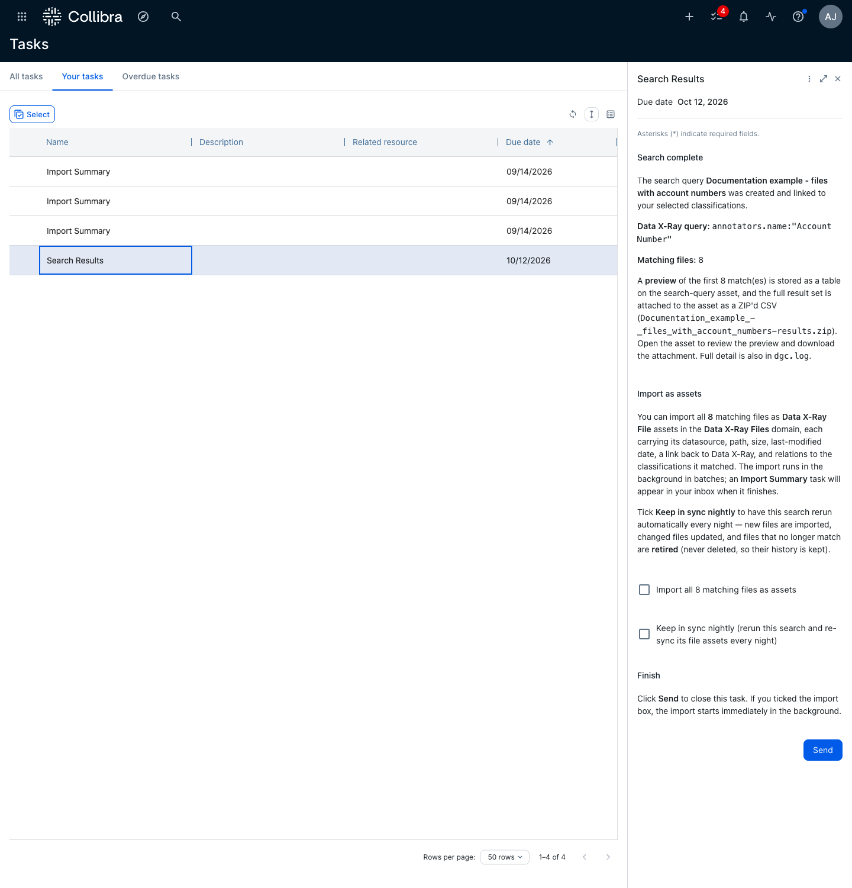
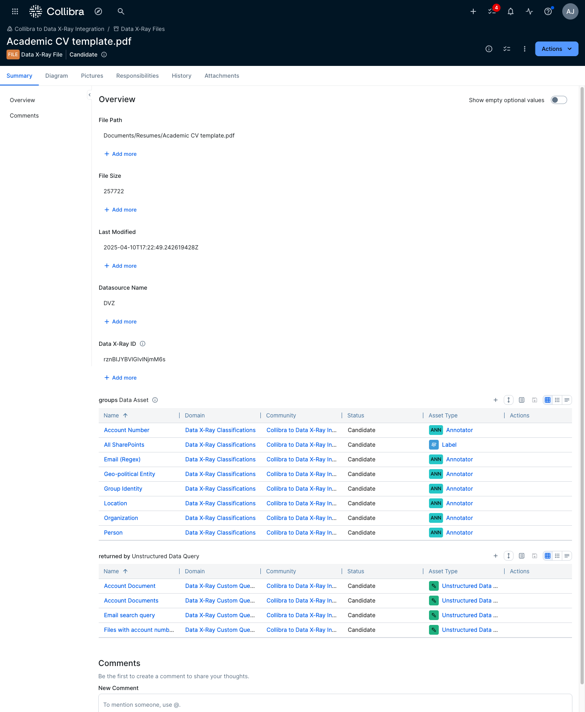
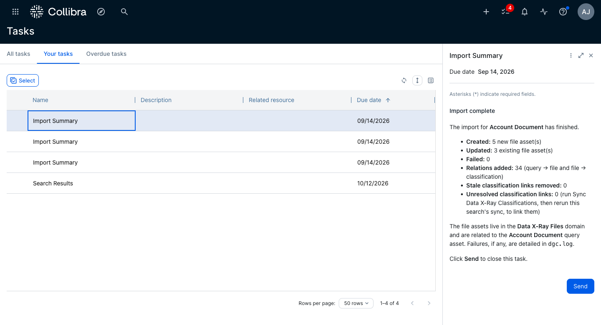
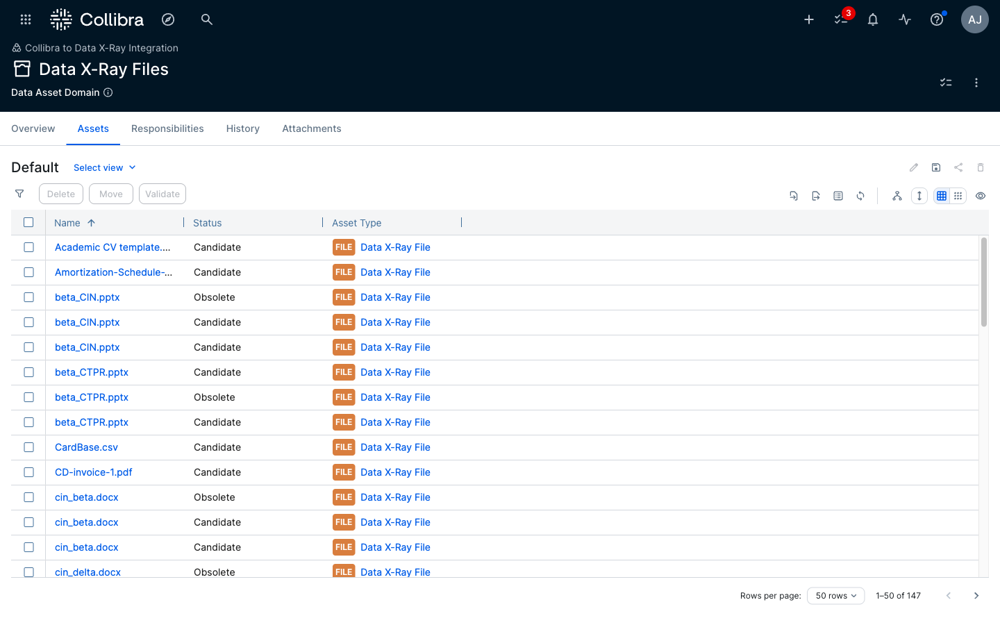
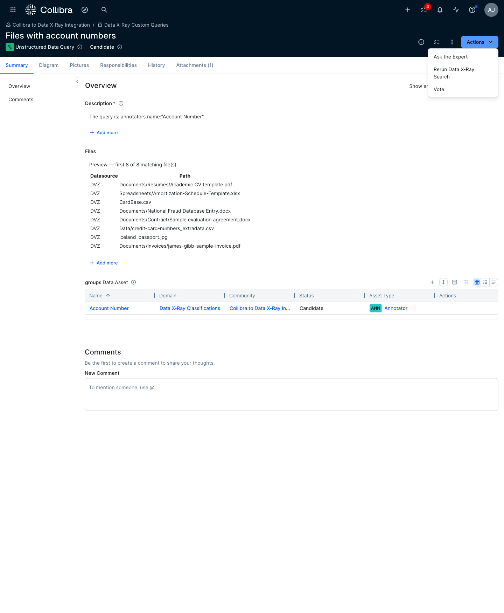
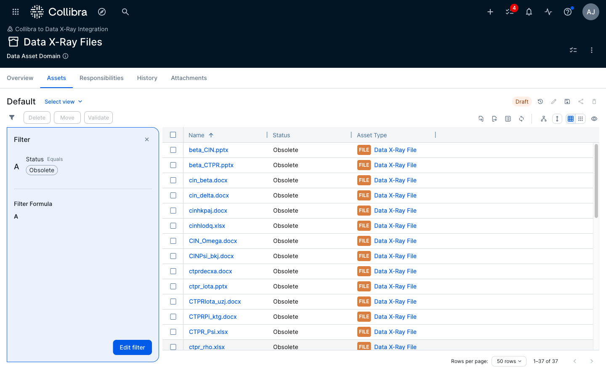

# DataXray File Assets — Sync & Lifecycle

This document explains how the DataXray workflows turn search results into
**DataXray File** assets in Collibra and what happens to those assets over
time: how they are created, how many there can be, how they are kept in sync,
how they drop out of every search, and what — if anything — ever deletes
them. It is written for Collibra administrators and DataXray Admins who
operate the integration; the companion [deployment guide](deployment-guide.md)
covers installation.

Terminology used throughout:

| Term | Meaning |
|---|---|
| **File asset** | An asset of type **DataXray File**, created in the **DataXray Files** domain. One per file in DataXray. |
| **Query asset** | An asset of type **DataXray Sync Filter** in the **DataXray Sync Filter** domain. Created by **Search DataXray**; one per saved search. |
| **Returns** | The relation from a query asset to each file asset its search currently matches (*query* **returns** *file* / *file* **returned by** *query*). This is the integration's record of "which searches this file belongs to". |
| **Formerly returns** | The relation a *returns* link becomes when the search stops matching the file (*query* **formerly returns** *file* / *file* **formerly returned by** *query*). It is a record only: it never counts as the file being returned. |
| **Formerly groups** | The same for a classification link: when DataXray no longer finds a label, extractor or annotator on a file, the file's *groups* link to it becomes *file* **formerly groups** *classification* / *classification* **formerly grouped by** *file*. |
| **Active** | Collibra status **Candidate** — the status every file asset is created with and set back to when a search matches it again. |
| **Not in any search** | A status created by **Configure DataXray Workflows** for file assets that no saved search returns any more. The asset and everything attached to it (attributes, relations, comments, attachments, history) is kept. Releases before v2.4 used **Obsolete** for this. |
| **Status set by a person** | Any status other than Candidate, Not in any search and Obsolete (for example Accepted, Under Review or Approval Pending). The integration never changes it. |
| **Rerun** | A run of **Rerun DataXray Search** for one query asset, started by a user from the asset's page or headlessly by **Sync DataXray Files (Nightly)**. |

Where everything lives: **Configure DataXray Workflows** creates one
community, **Collibra to DataXray Integration**, once per Collibra instance,
with three domains: **DataXray Classifications**, **DataXray Sync
Filter** and **DataXray Files**. There is no community or domain per DataXray
datasource; each file asset records its datasource in the **Datasource
Name** attribute.

## The lifecycle at a glance

```
       Search DataXray ("Import now"),             Rerun (manual or nightly):
       or a rerun that finds a new match *           the file still matches
                   │                                            │
                   ▼                                            ▼
  ┌──────────────────────────────────┐ attributes, links ┌──────────────┐
  │ created — status Candidate       │ ──── updated ───▶ │   updated    │
  │ query ──returns──▶ file          │                   │ (same asset) │
  └──────────────────────────────────┘                   └──────────────┘
                   │                                            ▲
     the file no longer matches this query (rerun)              │ a search
                   │                                            │ matches the
                   ▼                                            │ file again
  ┌──────────────────────────────────┐                          │ (rerun or
  │ the link becomes                 │                          │ import)
  │ query ──formerly returns──▶ file │                          │
  └──────────────────────────────────┘                          │
                   │  no query returns it any more              │
                   │  (or, after a query asset is deleted,      │
                   │  the nightly sweep)                        │
                   ▼                                            │
  ┌──────────────────────────────────┐  back to Candidate;      │
  │ status Not in any search         │  "returns" replaces      │
  │ (kept, never deleted)            │ ─ "formerly returns" ────┘
  └──────────────────────────────────┘
                   │
                   │  Cloud + Edge: the nightly check finds DataXray
                   │  no longer has the file (or its datasource)
                   ▼
  ┌──────────────────────────────────┐  back to Not in any search
  │ status Not in DataXray           │  if DataXray has it again;
  │ (kept, never deleted)            │  Candidate if a search matches
  └──────────────────────────────────┘
                   │
                   ▼  only by a person: bulk delete, filtered on
                deleted   status Not in DataXray (or Not in any search)

  * not for a query tagged dataxray-no-auto-import
  A status set by a person (Accepted, Under Review, ...) is never changed by
  any step above; the links still change.
```

The one-sentence version: **the integration creates and updates file assets
and marks the ones no search returns; it never deletes them, and it never
changes a status a person set.**

---

## How are file assets created?

File assets are only ever created by an **import** — either the one offered at
the end of **Search DataXray**, or a **rerun** of a saved search that finds
files it did not have before. Running a search on its own creates **no** file
assets: the results are stored on the query asset (a preview table and an
attached CSV), and the results task then offers three independent options:



| Option | Effect |
|---|---|
| **Import now: create assets for all N matching files** | Starts the import in the background as soon as you click **Send**. |
| **Keep in sync nightly** | Tags the query asset `dataxray-keep-in-sync`, which is what the nightly file sync looks for (see [How are file assets kept in sync?](#how-are-file-assets-kept-in-sync)). It does not require importing now. |
| **Create assets for new files found on later reruns** | Ticked by default. Untick it to tag the query asset `dataxray-no-auto-import`: reruns then refresh the file assets that already exist in Collibra but create none for files that only start matching later. |

The two sync options are offered whenever the search matched at least one
file, and they are saved as tags on the query asset as soon as you click
**Send**, whatever you chose about importing. You can add or remove either tag
on the query asset at any time; the change applies from the next rerun.

What the import does, per matching file:

1. **Works out the asset's identity.** A new file asset's UUID is derived
   from the file's DataXray file id, so the same DataXray file always maps
   to the *same* Collibra asset, no matter which search imports it or how
   often. In the Cloud + Edge edition the asset also records the file's
   **DataXray Datasource ID** and **DataXray Object ID**, and a file whose
   DataXray file id has changed is matched to its asset by those two (see
   [What counts as the same file?](#what-counts-as-the-same-file)). If the
   asset already exists it is updated in place, wherever it lives; it is
   never duplicated.
2. **Creates the asset** (if it does not exist) in the **DataXray Files**
   domain with type **DataXray File** and status **Candidate**. The asset's
   *display name* is the clean filename (`invoice.pdf`); its *full name* is the
   filename plus a short suffix derived from the UUID (`invoice.pdf [e8cf757f]`),
   because Collibra requires names to be unique within a domain and filenames
   repeat constantly. The name is set **only when the asset is created**: you
   can rename the asset in Collibra and no sync changes it back. DataXray's
   own name for the file is kept in the **DataXray File Name** attribute.
3. **Writes its attributes**: DataXray ID, DataXray File Name, File Path,
   File Size, Last Modified and Datasource Name (and a Link, when DataXray
   supplies one). These are overwritten on every sync, so they always reflect
   the last run: change them in DataXray, not in Collibra.
   File Size and Last Modified are written for people to read:
   `27.2 KB (27,885 bytes)` and `10 Apr 2025, 17:22 UTC`.
4. **Links it to the query** with a *returns* relation — the record that this
   search currently matches this file.
5. **Links it to the classifications it matched** (labels, extractors and
   annotators, using Collibra's *groups / is grouped by* relation) — but only
   where the DataXray result carries positive evidence: a label applied to
   the file, an extractor that produced metadata, an annotator with at least
   one hit. An annotator that was *checked* but found nothing is not a match
   and gets no relation. If a person has already linked the file to that
   classification, no second link is added. A classification that has not yet
   been synced into Collibra is skipped and counted as "unresolved" in the
   summary; run **Sync DataXray Classifications** and rerun the search to
   link it.



The import runs as a background job in **batches of 50** files, each in its own
transaction, so a large import never holds one giant transaction and one
failing batch never stops the rest (it is logged and counted as failed). When
the job finishes an **Import Summary** task arrives in the inbox of the person
who ran the search:



The imported assets appear in the **DataXray Files** domain:



---

## What counts as the same file?

A file asset follows the file's **DataXray file id**, and in the Cloud +
Edge edition also its **object key**: the datasource's id in DataXray plus
the object id the source system gives the file (its path on file shares and
buckets, its item id on SharePoint Online, OneDrive and similar). Every sync
stores both on the asset (attributes **DataXray ID**, **DataXray Datasource
ID** and **DataXray Object ID**).

- As long as DataXray keeps the file id, every sync updates the same asset,
  whatever else changes.
- **Cloud + Edge:** when DataXray assigns a new file id but the object key is
  unchanged, the sync finds the asset by its object key and keeps updating
  it, and the DataXray ID attribute takes the new id. This is what happens
  when a datasource's scanned data is dropped from DataXray's index and the
  datasource is scanned again: the files come back with new ids, and keep
  their assets, comments, attachments, history and community placement.
- When both change, Collibra sees a new file: the next rerun of a matching
  search creates a new asset, and the old one drops out of the search (see
  [How are file assets orphaned?](#how-are-file-assets-orphaned)).
- **On-prem:** DataXray's public files API does not return the object id
  (October 2026), so the on-prem edition follows the file id only.

An asset created by a release before v2.6 gets its object key the next time
a sync updates it. Rerun your searches (or let the nightly sync run) once
after upgrading, before you drop a datasource's data from the index, so that
every asset has one.

Whether a file keeps its id (or its object id) depends on the DataXray
connector of its datasource:

| Connector | DataXray identifies a file by | Rename or move within the datasource |
|---|---|---|
| SMB, local / NFS, SFTP | its path | **New file id** → new asset |
| Amazon S3, Azure Blob, Google Cloud Storage | its object key / blob name | **New file id** → new asset |
| SharePoint on-premises | its path in the library | **New file id** → new asset |
| SharePoint Online | the library plus SharePoint's item id | Same asset within a library; **new file id** when moved to another library |
| OneDrive, Google Drive, Gmail, Box | the service's own item id | Same asset |
| Connector plugins | whatever id the plugin reports | Depends on the plugin |

For **every** connector, a file gets a new id when it is copied or moved to
another datasource, or when its datasource is deleted and created again (the
new datasource has a new id, so the object key changes too). A copy is a
separate file: the original keeps its asset, and the copy gets its own.
Dropping a datasource's scanned data and scanning it again also gives every
file a new id, but keeps the object key: see above.

A new asset starts clean. Comments, attachments, history and any move to
another community stay with the old asset.

---

## How is the maximum number of file assets controlled?

There are two limits:

- **10,000 files per run.** A search matching more than 10,000 files cannot
  be imported (or kept in sync nightly): the results task asks you to refine
  it. A rerun that would create more than 10,000 *new* file assets is refused
  the same way; a rerun that only refreshes existing assets is not. Large
  imports (above 5,000 files) are allowed with a warning that they take a
  while.
- **An instance-wide cap of 25,000 file assets.** The cap counts every asset of
  type **DataXray File** on the instance, wherever it lives: file assets moved
  out of the **DataXray Files** domain into other communities count too. The
  cap exists to keep imports, nightly syncs and the Collibra instance itself
  responsive; it is a fixed constant in the workflow scripts, not a setting that
  can be changed in the Collibra UI (contact Ohalo if your deployment needs a
  different limit).

Key facts about how it is applied:

- **The cap is a total, not a per-import limit.** Before every import or rerun the
  workflow counts *every* DataXray File asset in Collibra and adds the
  number of new assets the run would create. If that projected total exceeds
  25,000, the run is refused and nothing is imported.
- **File assets in every status count.** A file asset with status **Not in
  any search** (or **Obsolete**, or a status set by a person) still occupies
  one of the 25,000 slots until a human deletes it. See
  [What to do when you reach the limit](#what-to-do-when-you-reach-the-limit).
- **The projection is deliberately conservative.** For a new search, the
  projection is *current population + number of matching files* — even though
  some of those files may already exist from other searches (and would only be
  updated). For a rerun, files the query already returns are excluded (they
  are updates), but overlap with *other* queries' files is still counted as
  new. So the check can refuse slightly early; it never lets the total go
  over.
- **A rerun that creates nothing is not refused.** A rerun of a query tagged
  `dataxray-no-auto-import` adds no new assets, so the cap does not stop it.
- **It is enforced in the scripts, not just the form.** The results task hides
  the import controls when the cap would be exceeded, but the import job
  re-checks the projection when it starts, so the limit cannot be bypassed by
  completing the task through the REST API.

What you see when the cap is hit:

| Situation | Behaviour |
|---|---|
| A search's results task, and the projected total would exceed 25,000 | The import checkbox is not shown. Instead the task shows: *"Importing is disabled for this search: the DataXray Files domain holds N file asset(s) and this search matched M file(s) — the projected N+M would exceed the 25000 instance-wide limit. Narrow the query, or retire imported searches you no longer need."* N is the count of every DataXray File asset, including moved ones. |
| A search matched more than 10,000 files | Import and *Keep in sync nightly* are not shown. The task says: *"Importing is disabled for this search: it matched N file(s), more than the 10,000 a search can import. Refine the search …"* The import job refuses it too, if the task is completed through the REST API. |
| A search matched more than 5,000 files (up to 10,000) and is within the cap | Import is offered, with a *"Large import — expect it to run for a while in the background"* warning. |
| A rerun would create more than 10,000 new file assets | The rerun is refused (*"… more than the 10,000 one run may create"*); nothing is changed. Tag the query `dataxray-no-auto-import` to refresh only the files already imported. |
| An import is refused when it starts (for example, another import finished in the meantime) | The import stops with *"Import refused: Collibra holds N DataXray file asset(s) and this search matched M …"*. Nothing is imported. |
| A **manual** rerun (from the query asset's page) would exceed the cap | The rerun stops immediately with an error (*"Collibra holds N DataXray file asset(s) and this rerun would add M more …"*) naming the projected total. Nothing is changed. |
| The **nightly** reruns a keep-in-sync query that would exceed the cap | The rerun is refused, logged in `dgc.log`, and ends cleanly. That query's file assets are left exactly as they were; other queries are unaffected. It will be refused again every night until the population is reduced or the query narrowed. |

---

## How are file assets kept in sync?

A file asset is a snapshot of what DataXray reported the last time a search
that returns it was run. It is brought up to date by a **rerun** of any query
that returns it:

- **Manually** — open the **DataXray Sync Filter** asset and start
  **Rerun DataXray Search** from its **Actions** menu. A **Rerun complete**
  summary task reports what changed.
- **Automatically** — **Sync DataXray Files (Nightly)** runs every night at
  **02:30** (server time), finds every query asset tagged
  `dataxray-keep-in-sync`, and starts one headless rerun per query. It runs
  after the 02:00 classification sync so renamed or removed classifications are
  already current when the queries are rebuilt.



A rerun rebuilds the search from the query asset's linked classifications (so
renames in DataXray are picked up automatically), fetches the current
results, and then for each matching file:

| Change in DataXray | Effect on the Collibra file asset |
|---|---|
| New file matches the search | A new file asset is created and linked (as in an import). |
| New file matches the search, and the query is tagged `dataxray-no-auto-import` | No asset is created. The **Rerun complete** task counts it under *Not imported*. If the file already has an asset (another search imported it), that asset is refreshed and linked to this query as usual. |
| File renamed or moved, and DataXray kept its file id (see [What counts as the same file?](#what-counts-as-the-same-file)) | The **same** asset is updated: DataXray File Name, File Path and the other attributes are refreshed. The asset's name is not changed (it may be one a person gave it). |
| File renamed or moved, and DataXray assigned a new file id (e.g. on an SMB share) | A **new** asset is created; the old one drops out of the search as described below. |
| Size / last-modified changed | Attributes refreshed. |
| A person renamed the asset in Collibra | Kept. Syncs never change an asset's name after creating it; DataXray's name is in the DataXray File Name attribute. Any **attribute** a person changes in Collibra is overwritten by the next sync. |
| A label was added, or an annotator/extractor now has hits | A *groups* relation to that classification is **added**. If the file had a *formerly groups* link to it, that link is replaced. If a person already linked the file to that classification, nothing is added. |
| A label was removed, or a classification no longer has hits on the file | The *groups* relation becomes **formerly groups**, so the change stays visible on the file asset. This applies only to links the integration created; see below. |
| A person linked the file to a classification by hand | The link is never removed or changed, whatever DataXray reports. |
| The file had status **Not in any search** (or **Obsolete**, from a release before v2.4) and matches again | The status goes back to **Candidate**, history intact, and this query's *formerly returns* link becomes *returns* again. |
| A person set the file asset's status (Accepted, Under Review, …) | The status is kept. Attributes and relations are still refreshed and links are still swapped. |
| The file no longer matches this search | See the next section. |

**Which links count as the integration's own.** Collibra records who created
each relation. The integration's background tasks run as Collibra's built-in
**Workflow** user, so every *groups* link the integration creates is recorded
as created by that user, and those are the only file-to-classification links a
sync ever removes or swaps. A link created by a person (or by any other
process) is left exactly as it is. One caveat: links created by your **own**
Collibra workflows are also recorded as created by the Workflow user, so the
integration cannot tell them apart from its own and may swap them to
*formerly groups* when DataXray no longer reports the classification.

Controlling the nightly sync per query:

- **Pause**: retire the query asset (set its status to **Obsolete**). The
  nightly skips retired queries even if still tagged; its file assets are left
  as they are. Reactivate the query to resume. A manual rerun still works on a
  retired query.
- **Stop**: remove the `dataxray-keep-in-sync` tag from the query asset. Its
  file assets stay exactly as they are (they are still *returned* by the
  query, so nothing changes their status).
- **Start**: add the tag to any query asset — including one whose search was
  never imported.
- **Refresh only**: add the `dataxray-no-auto-import` tag. Reruns, manual or
  nightly, then refresh the file assets that already exist and create none for
  new matches. Remove the tag to let reruns create assets again.

Because the integration mirrors the source system, Collibra reflects DataXray
*as of the last sync*. Changes in DataXray appear after DataXray has
re-indexed and the next rerun has run — with nightly-only syncing that is up to
about a day; a manual rerun closes the gap immediately.

---

## How are file assets orphaned?

A file asset is **orphaned** when **no query returns it any more** — it has no
*returns* relation from any query asset (*formerly returns* links do not
count). Orphaned file assets get the status **Not in any search**, unless a
person set their status, which is kept. There are two ways this happens.

### 1. A rerun finds the file no longer matches

At the end of every rerun, the query's *previous* set of returned files is
compared with the *current* results:

1. For each file the query returned last time but not this time, the
   *returns* relation from **this** query is replaced by a **formerly
   returns** relation. The file asset shows which search used to return it.
2. The workflow then checks whether **any other** query still returns the
   file. If one does, the asset keeps its status (Candidate) and that other
   query's *returns* link: it is still a legitimate result of that other
   search. If none does, the asset's status becomes **Not in any search**.

So a file returned by two searches only becomes Not in any search once
**both** stop returning it; until then only the first search's link is a
*formerly returns* link. If a search matches the file again later, its
*formerly returns* link becomes *returns* again and the status goes back to
Candidate. The summary task reports both numbers separately (*No longer
returned* vs *In no search*):

| Scenario | Outcome |
|---|---|
| File deleted in DataXray | Disappears from every search's results → each search's link becomes *formerly returns* as it reruns → Not in any search once the last one has rerun → in the Cloud + Edge edition, **Not in DataXray** at the next nightly check (see [3](#3-dataxray-no-longer-has-the-file-cloud--edge)). |
| File changed so it no longer meets the criteria (e.g. a label removed) | That query's link becomes *formerly returns*; the status changes only if no other query returns it. |
| Search criteria narrowed (a criterion removed in DataXray is *not* silently dropped — the rerun fails instead, see the deployment guide) | Files outside the new criteria get *formerly returns* links, then Not in any search if no query returns them. |
| DataXray re-scanned a datasource and assigned **new file ids** | The new generation is created as new assets; the old generation becomes orphaned and gets Not in any search, with its history intact. |
| File renamed or moved on a connector that identifies files by path, or moved to another datasource | The same, for that one file: a new asset for the new file id, the old asset Not in any search. |
| Datasource deleted in DataXray | Its files disappear from every search's results and get Not in any search as each search reruns, then (Cloud + Edge) Not in DataXray at the next nightly check. A search that matched *only* that datasource now returns nothing, so the zero-results rule below leaves its files as they are; delete the query asset to release them. |

### 2. The query asset itself was deleted

Deleting a **DataXray Sync Filter** asset in Collibra deletes its
*returns* relations with it. No rerun can ever update the files it exclusively
returned, because the query that would have done so no longer exists. The
nightly file sync therefore ends every run with an **orphan sweep**: it lists
every DataXray File asset in Collibra, wherever it lives, that has **no**
*returns* relation from any query and sets those that are still Candidate (or
Obsolete) to **Not in any search**. Files other queries also return are
untouched, and so are files whose status a person set.

The sweep only acts on a complete picture: if listing the relations or the
file assets fails part-way, the sweep is skipped for that night and retried the
next (orphans wait one more night rather than risk changing statuses on
partial data).

**After upgrading from a release before v2.4**, the first nightly file sync
also moves every orphaned file asset that an earlier release set to
**Obsolete** to **Not in any search**. This happens once; from then on
Obsolete is never set on file assets.

### 3. DataXray no longer has the file (Cloud + Edge)

A search can only say that a file no longer matches it. It cannot say why: the
file may still be in DataXray and simply have stopped matching (a label was
removed), or it may have been deleted. So in the Cloud + Edge edition the
nightly file sync ends with an **existence check**: it asks DataXray about
every file asset that is **Not in any search** or **Not in DataXray**.

- Each file is looked up by its **DataXray Datasource ID** and **DataXray
  Object ID**, the identity that survives DataXray dropping a datasource's
  scan results and scanning it again (see [What counts as the same
  file?](#what-counts-as-the-same-file)).
- **DataXray does not have the file** → status **Not in DataXray**. This is
  the file deleted in DataXray, or its whole datasource deleted there.
- **DataXray has the file** → nothing changes. A **Not in DataXray** asset
  whose file DataXray has again goes back to **Not in any search**, and to
  **Candidate** as soon as a search matches it.
- **A status a person set is never changed.** Only assets that are Not in any
  search or Not in DataXray are checked.
- DataXray updates a datasource's index in place while it scans, one changed
  file at a time, so a scan in progress never makes files look deleted.

The check asks about 200 files per request through Edge (about a second
each), so 2,000 files no search returns take about 10 requests. If DataXray
stops answering, the check stops for the night; files already checked keep
their new status and the rest are checked the next night.

**Not checked:** a file asset that has no DataXray Datasource ID / Object ID.
Every sync from v2.6 on stores both, and a file only becomes Not in any search
after being synced, so this only affects file assets that were already Not in
any search when the workflows were upgraded to v2.6 or later. They stay Not in
any search. The on-prem edition does not run the check: DataXray's public
files API does not return object ids.

> Deleting a query also discards its attached results CSV and its history. If
> the aim is only to stop syncing, prefer removing the tag or retiring the
> query — see [How are file assets kept in sync?](#how-are-file-assets-kept-in-sync).

### Safety rails — when files are deliberately left alone

- **A rerun that returns zero results changes no statuses or links.** An empty
  answer from DataXray is far more likely to be an outage or truncated
  response than a search that genuinely matches nothing; marking a query's
  whole population as no longer returned on that basis would be wrong. The
  result set is fetched with up to three attempts, and if all fail the rerun
  stops with an error and changes nothing. The flip side: a search that
  genuinely matches nothing any more (for example, its only datasource was
  deleted in DataXray) keeps its files as they are until it matches
  something again or the query asset is deleted.
- **An aborted or partial rerun changes nothing.** If the run is refused (cap
  exceeded, connection not configured, a criterion deleted in DataXray,
  started on the wrong asset type, Configure not yet re-run after an
  upgrade), or could not fetch every result, the pass that swaps links and
  sets Not in any search does not run.
- **A status set by a person is never changed** by the rerun, the sweep or
  the existence check. Only Candidate, Not in any search, Not in DataXray and
  Obsolete are managed by the integration. A file asset someone marked Accepted, for example, is never
  made Not in any search by DataXray.
- **Files already Not in any search or Not in DataXray are left alone** by
  both the rerun and the sweep; only the existence check moves them between
  the two.

---

## Can file assets be moved to another community?

Yes. The integration tracks file assets by their UUID, not by domain, so an
asset a user moves into a domain in another community (a business unit's, say)
stays there. Every later sync updates its attributes and relations in place and
never moves it back. Two conditions come from Collibra, not the integration:
the target domain's type must allow the **DataXray File** asset type, and the
person moving it needs permission on both domains.

Moved file assets keep syncing wherever they are. The integration's background
tasks run as Collibra's Workflow user, which has no permission restrictions,
and the check for an existing asset is instance-wide (the asset id is derived
from the DataXray file id), so a moved asset is updated in place and no
duplicate is created in the DataXray Files domain.

Things to know before relying on it:

- **A placement lasts as long as the file id.** If DataXray assigns the file a
  new id, for example when it is renamed or moved on an SMB share (see
  [What counts as the same file?](#what-counts-as-the-same-file)), the new asset
  is created in the **DataXray Files** domain and the moved one gets Not in
  any search where it is.
- **Moved file assets count towards the 25,000 cap and are included in the
  nightly orphan sweep.** Both work on every DataXray File asset, wherever
  it lives.
- **Deleting the community or domain deletes the asset with it.** If a search
  still matches the file, its next rerun recreates the asset in the **DataXray
  Files** domain. Only that search's *returns* relation comes back at once; the
  others return as each search reruns.
- **Who can see a moved asset is decided by its new domain.** If the aim is to
  restrict who sees files, you do not need to move them: view permissions can
  be set on the DataXray Files domain itself. See *Who can see what* in the
  [deployment guide](deployment-guide.md#who-can-see-what).

---

## How are file assets deleted?

**They are not — not by the integration.** No workflow in this bundle deletes
a file asset (or a classification asset, or a query asset). Every path that
removes a file from the picture ends in **Not in any search** (or, in the
Cloud + Edge edition, **Not in DataXray** once DataXray no longer has the
file), so comments,
attachments, history and the file's relations survive as a record.

Deletion is a **manual, administrative action**, done in the Collibra UI (or
via the REST API) by someone who holds a delete-capable responsibility on the
DataXray Files domain (or wherever the asset has been moved) or is a
Sysadmin. Collibra's default permission model means ordinary users cannot
delete assets at all, and the deployment guide asks you to keep it that way
for the Files and Classifications domains — treat them as sync-owned.

What to expect if file assets *are* deleted by hand:

| You delete… | Then… |
|---|---|
| A file asset with status **Not in DataXray** | Nothing further happens: DataXray no longer has the file, so no search can bring it back. The safest files to delete. |
| A file asset with status **Not in any search** | Nothing further happens. This is the safe, intended way to reclaim capacity (see below). If the file later matches a search again it is simply created afresh as a new asset (same UUID, but its old history is gone). |
| An **active** file asset that a search still matches | The next rerun of that search (manual or nightly) **recreates** it — same UUID, same name, fresh attributes and relations — because the deterministic identity means the workflow simply sees a file it has not imported yet. Its comments and history are not restored. A query tagged `dataxray-no-auto-import` does not recreate it. |
| A **query asset** | Its file assets are **not** deleted. Those no other query returns get Not in any search at the next nightly orphan sweep (see above). |
| A **classification asset** | Not recommended — see the acceptance criteria (CAT-10). The next classification sync recreates it and file assets are relinked as their searches rerun, but saved searches that used it silently lose that criterion. Because criteria are AND-ed, they then return *more* files; a search left with no criteria stops with an error instead. |
| A **community or domain** containing file assets | Collibra deletes the file assets with it. Each is recreated in the **DataXray Files** domain by the next rerun of a search that still matches it (same UUID, no comments or history). See [Can file assets be moved to another community?](#can-file-assets-be-moved-to-another-community). |

---

## What to do when you reach the limit

You have reached the limit when a search's results task shows *"Importing is
disabled for this search…"*, a manual rerun stops with *"…would exceed the
25000 instance-wide limit"*, or `dgc.log` shows nightly reruns being refused
for the same reason. Because **file assets in every status count**, freeing
capacity always ends with deleting file assets that are Not in any search; the
steps below get you there safely.

### 1. See where the capacity is going

Search for assets of type **DataXray File** (or open the **DataXray Files**
domain, if none have been moved) and group or filter the asset table by
**Status**. Two numbers matter: how many assets are **Not in any search**
(reclaimable immediately) and how many are **Candidate** (active — each is
still returned by at least one search). Adding the **returned by** relation as
a column shows which searches account for the active ones. File assets with a
status a person set are outside the integration's lifecycle; decide about
those separately.

If you upgraded from a release before v2.4, file assets that an earlier
release set to **Obsolete** are moved to Not in any search by the first
nightly file sync after the upgrade. Until that has run, filter on Obsolete as
well.



### 2. Delete file assets that are Not in any search

Not in any search is the integration's "no search needs this any more"
signal; deleting these assets loses only their history. Filter to **Status =
Not in any search**, select all, and use Collibra's bulk **Delete**. This is
the *only* deletion the integration expects, and the safest.

If you want to keep a record of them (for example for audit purposes), export
the filtered table to CSV before deleting. Do not move them to another domain
instead: moved file assets still count towards the cap, and the workflows
track file assets by UUID, not by domain, so a moved asset would be updated
and set back to Candidate *where it is* the next time the file matches a
search.

### 3. Release the searches you no longer need

Active file assets can only be reclaimed by first making them orphans. For
each saved search whose files are no longer wanted:

1. Note which of its files are also returned by other searches (those will
   stay active, correctly).
2. **Delete the query asset**. Its *returns* relations go with it.
3. Wait for the nightly file sync (02:30) — its orphan sweep sets every file
   asset no remaining query returns to Not in any search. (An administrator
   can also start **Sync DataXray Files (Nightly)** immediately via the
   REST API, `POST /rest/2.0/workflowInstances`, rather than waiting.)
4. Delete those file assets as in step 2.

Merely removing the `dataxray-keep-in-sync` tag or retiring the query asset
does **not** free anything: its file assets remain *returned* by it and stay
active. To stop a search adding to the population without releasing what it
already has, tag it `dataxray-no-auto-import`.

### 4. Narrow the searches you keep

For searches that are useful but broad, tighten the criteria (all criteria are
AND-ed, so adding a label, extractor or annotator only ever shrinks the result
set). Create the narrower search with **Search DataXray**, import it, and
then delete the broad query asset as in step 3 — files matched by both are
reused by the new query and stay active; the rest are orphaned and get Not in
any search.

### 5. If the limit itself is the problem

The 25,000 cap is a constant in the workflow scripts, chosen to keep imports
and nightly syncs within the volumes Collibra's workflow engine handles
comfortably. If your organisation's legitimate footprint is larger, contact
Ohalo — raising the limit is a change to the workflow bundle, after which you
re-import the updated workflows (an in-place update; no reconfiguration is
needed).

---

## Quick reference

| Question | Answer |
|---|---|
| What creates a file asset? | An import from a search's results task, or a rerun that finds a new match (not for a query tagged `dataxray-no-auto-import`). Never a search on its own. |
| What is a file asset's identity? | Its DataXray file id — the Collibra UUID is derived from it, so the same file is always the same asset. On path-based connectors (SMB, file shares, S3, Azure Blob, SharePoint on-premises) a rename or move gives the file a new id, and so a new asset. |
| Can I rename one? | Yes. The name is set once, when the asset is created, and no sync changes it. DataXray's current name is in the **DataXray File Name** attribute. The other attributes always come from DataXray. |
| Which domain / type? | Created in **DataXray Files** / **DataXray File**, status **Candidate** when active. |
| Can I move one to another community? | Yes; syncs update it where it is, and it still counts towards the cap and is included in the nightly sweep. The placement is lost if DataXray assigns the file a new id. |
| Maximum number? | **10,000** new file assets per import or rerun, and **25,000** DataXray File assets in total, wherever they live and whatever their status; warning above **5,000** per import. Fixed in the scripts. |
| What keeps them current? | Manual **Rerun DataXray Search** on the query asset, or the **02:30 nightly** for queries tagged `dataxray-keep-in-sync`. |
| When does one get Not in any search? | When no query returns it any more — after a rerun stops returning it, or after the nightly orphan sweep finds it with no *returns* relation (deleted query). Never if a person set its status. |
| What happens to links that stop applying? | *returns* becomes *formerly returns*, and an integration-made *groups* becomes *formerly groups*. Both swap back if they apply again. Links a person created are never touched. |
| When does one get Not in DataXray? | Cloud + Edge only: when it is Not in any search and the nightly check finds DataXray no longer has the file, or its datasource. Never if a person set its status. |
| When is one deleted? | Only by a person. The integration never deletes. |
| When does one go back to Candidate? | As soon as any search's import or rerun matches it again, unless a person set its status. |
| How do I free capacity? | Delete file assets that are Not in any search; to release active ones, delete their query asset and let the nightly sweep run, then delete. |
